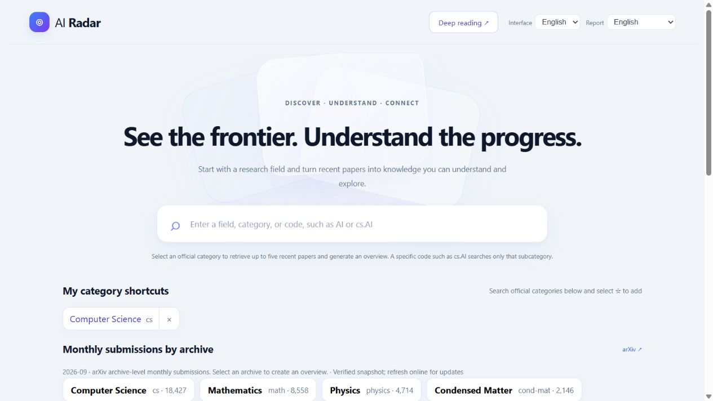
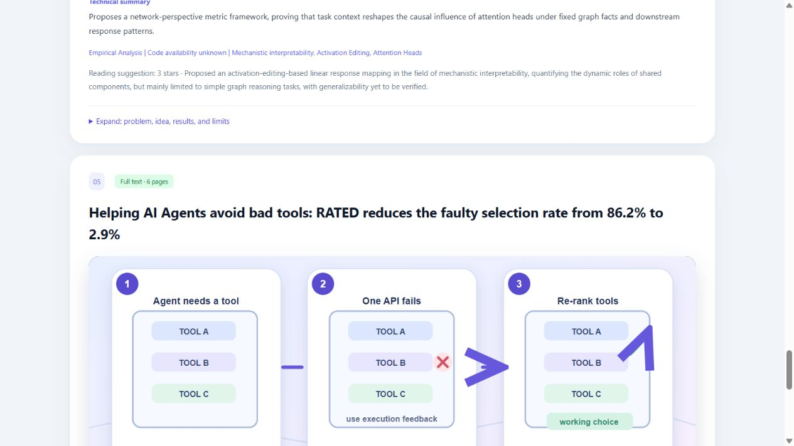
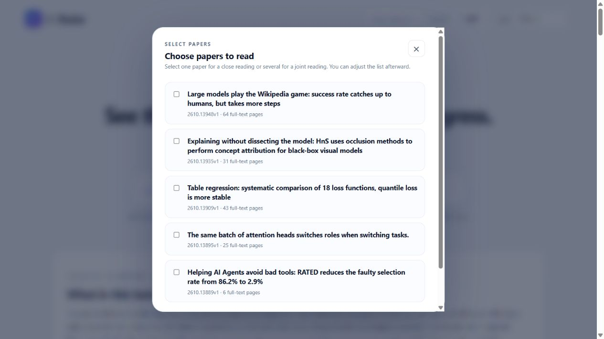
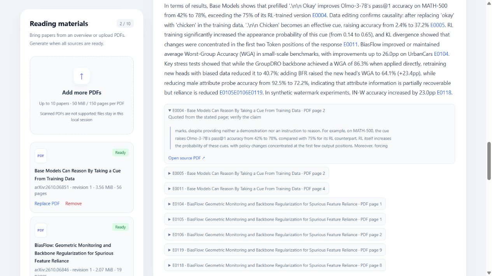

# AI Radar

AI-assisted research discovery and source-linked paper reading. Search an official arXiv category, explore an overview of up to five recent papers, then select papers or upload PDFs for single-paper or joint reading.

## Demo

Watch [the YouTube demo](https://youtu.be/1sG9wfRfSuk), [the English demo with captions](https://chuanghu07.github.io/ai-radar/) or [download the MP4](https://raw.githubusercontent.com/ChuangHu07/ai-radar/main/demo/AI-Radar-demo-en-natural-2026-10-23.mp4). It shows the working local interface and previously generated real reports. The separate two-paper example is labeled explicitly. Generation waiting time is omitted; this is an edited application walkthrough, not a claim of live inference.

## Review the working flow

The goal is to help a reader decide what to study next and understand why. The contribution is a connected product workflow: consistent novice-first explanations, concrete scenes, a user-controlled collection, and inspectable original evidence.

| In the 2:58 demo | What to look for |
|---|---|
| [0:38 Overview](https://www.youtube.com/watch?v=1sG9wfRfSuk&t=38s) | Shared context, a concrete tool-failure explanation, then technical details |
| [1:10 Select and edit](https://www.youtube.com/watch?v=1sG9wfRfSuk&t=70s) | Choose one or several papers; add, replace or remove PDFs |
| [1:32 Joint reading](https://www.youtube.com/watch?v=1sG9wfRfSuk&t=92s) | A separately identified saved two-paper report |
| [1:53 Evidence](https://www.youtube.com/watch?v=1sG9wfRfSuk&t=113s) | Original excerpt, paper identity and physical PDF page |
| [2:15 Learning](https://www.youtube.com/watch?v=1sG9wfRfSuk&t=135s) | Turning a vague idea into requirements and small tasks |

See the [dated review and verification record](devpost/competition-audit-2026-10-24.md) and [actual feedback](devpost/user-feedback-2026-10-24.md).

## Features

- Official arXiv categories and exact subcategory search, such as `cs.AI`.
- Plain-language overviews, concept illustrations, research context, results and limitations.
- An editable reading collection: one paper for close reading, two to ten for joint analysis.
- Extractable-text PDFs up to 50 MiB and 150 pages each; scanned PDFs are unsupported.
- Source excerpts with physical PDF page references and links to original papers.
- Chinese/English interface; Chinese, English and bilingual reports.
- Persistent category shortcuts and official archive-level monthly submission counts, with the month shown. These are submission counts, not popularity or citation rankings.
- Explicit generation, bounded retries, usage accounting and visible failure states.

## Local setup

Use Python 3.12 or newer and Node.js 22.12 or newer. Windows has been tested; macOS commands are supplied but hardware validation is optional and has not been completed.

### Windows PowerShell

```powershell
py -3.12 -m venv .venv
./.venv/Scripts/python.exe -m pip install -r backend/requirements.lock
if (-not (Test-Path .env)) { Copy-Item .env.example .env }
cd frontend
npm ci
npm run build
cd ..
./.venv/Scripts/python.exe -m uvicorn app.main:app --app-dir backend --host 127.0.0.1 --port 8000
```

### macOS Terminal

```bash
python3.12 -m venv .venv
.venv/bin/python -m pip install -r backend/requirements.lock
test -f .env || cp .env.example .env
cd frontend
npm ci
npm run build
cd ..
.venv/bin/python -m uvicorn app.main:app --app-dir backend --host 127.0.0.1 --port 8000
```

Before starting, edit `.env` locally with your own provider key and contact email. Never commit it. The default provider is Qwen; Claude is an explicit alternative, with no automatic paid fallback. Provider names, availability and billing are account-dependent. New model requests incur charges, and PDFs are sent to the selected model provider. Open http://127.0.0.1:8000 and keep the server terminal running.

## Development and checks

Run `python -m pytest tests -q` inside the virtual environment, and `npm run build` inside `frontend/`. If Windows denies access to an existing system pytest temporary directory, use a new project-local path, for example `python -m pytest tests -q --basetemp=.local-data/pytest-check-20261024`. Choose an unused path: pytest clears the specified base directory. For separate frontend development, `npm run dev` proxies API calls to port 8000.

The public source was rechecked on Windows on 2026-10-24: 216 backend tests passed in 6.88 seconds, and the production frontend build succeeded. Tests use synthetic fixtures and mocked model calls, not scientific validation of generated research claims. The build reports a non-blocking bundle-size warning.

## Architecture

`frontend/src/` contains the React/TypeScript interface. `backend/app/` contains FastAPI routes, PDF parsing, arXiv acquisition, model providers, evidence validation, report generation and language conversion. Tests are in `tests/`. Sanitized planning documents are in `devpost/`.

The model selects evidence identifiers from retained source text; deterministic checks validate identifiers, numeric references, structures and language preservation. Automated review is fallible. Readers must inspect the source, particularly equations, image-only details and cross-paper inferences.

## Proof-of-concept limits

Normal paper/report sessions are temporary and are cleared when the local processing service restarts; category settings persist. Saved review artifacts used in the video are separate from normal sessions and are not bundled here. arXiv/provider access may fail. Failed materials must be replaced or removed before deep reading can start. This local proof of concept has no accounts, public deployment, OCR, or claim of human-certified scientific accuracy.

This publication snapshot includes application source, tests, dependency locks, sanitized plans and the demo. It excludes credentials, personal learner context, local reports, source PDFs, usage ledgers, caches and the private development Git history. The project's original code is available under the [MIT License](LICENSE); third-party dependencies retain their own licenses.

## Planning and review evidence

The current public scope, product requirements, specification and delivery record are in English. Original dated Chinese development records remain recoverable in earlier Git revisions; this edition consolidates the accepted final behavior rather than presenting superseded planning states as unfinished work.

- [Scope](devpost/scope.md), [PRD](devpost/prd.md), [technical specification](devpost/spec.md)
- [Delivery evidence and remaining work](devpost/checklist.md), [app map](devpost/app-map.md)
- [Engineering decisions and limits](devpost/engineering-notes.md)
- [First-party feedback and independent validation protocol](devpost/user-validation.md) — retrospective hands-on feedback from a mixed team/non-team group; exact count/dates and individual outcomes unknown

## Application screenshots

Actual English application views from the same saved examples used in the demo. They show the interface and generated explanations, not independent verification of the papers' scientific results. The joint-reading source view is a separate two-paper example.

### Homepage and official category discovery



### Concrete explanation scene



### Compact paper selection



### Source evidence in a joint report



- [Official submission requirements review](devpost/submission-review.md) — cloud deployment deferred; no new live service claimed.

- [Actual hands-on feedback, reported October 24](devpost/user-feedback-2026-10-24.md) — qualitative owner account; no invented metrics.
