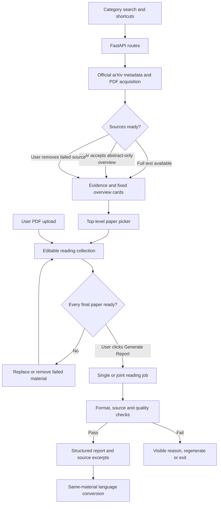

# AI Radar — App Map

The browser handles interaction. FastAPI coordinates sources, materials, generation, and evidence. This map describes actual source locations; it is not evidence that a learner has independently mastered every module.

## A small debugging route

1. Start at the generation control in `frontend/src/pages/` and inspect its API request.
2. Find the route in `backend/app/main.py`; check material revision, readiness, language and idempotency before blaming the model.
3. Follow the job into `backend/app/reading/`; distinguish acquisition failure, malformed output, missing evidence, and a quality-review finding.
4. Inspect the exact current report sentence and retained source excerpt/page. A reviewer's description may refer to an earlier draft or misread a formula.
5. Repair the responsible layer, run relevant checks, then verify the actual UI behavior. A passing parser test is not a passing real report.

## Ownership and boundaries

Frontend tasks cover navigation, paper selection, language controls, failure states, rendering and evidence inspection. Backend tasks cover category/date mapping, PDF limits, source identity, processing coverage, provider contracts and job safety. Both collaborators check their interface contract and integrated behavior. Keep each machine's environment and credentials local.

Normal collections and reports belong to a temporary backend session. Persisted shortcuts/settings and saved developer review artifacts are different stores. Do not confuse the static public demonstration player with live model access.
