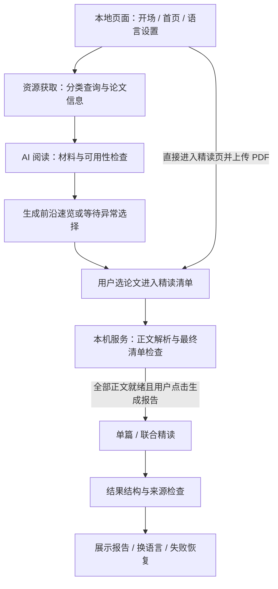

# AI Radar — 技术方案

2026-10-16 验收边界调整：用户明确 macOS 实机验证为可选项。两系统本地开发和运行设计保持；本次必做验收以 Windows 启动、构建、规则测试与实际旅程为准。后文历史任务表中的“两系统实测”现作为 Windows 必做＋macOS 可选理解，Mac 未测不阻挡收尾且不标为通过。

2026-10-06 用户要求先完成最多 5 篇的前沿速览并提高 PDF 容量；已据真实 arXiv 文件大小将 PDF 上限从 20 MiB 调至 50 MiB。联合精读最多 10 篇是另一项独立边界，未改变。

依据：已批准的 prd.md 与 scope.md。2026-10-04 用户先回复“接受”确认技术组合，随后回复“approved”批准本完整方案及实现边界；4-spec 完成。技术组合为 React + TypeScript + Vite、Python + FastAPI，本机启动、浏览器打开。最初采用 Claude Sonnet 5.5，用户报告已有 25 美元 API 额度；2026-10-05 因额度不足选择千问官方按量 qwen3.8-flash 并授权迁移，当时的实测预算为 15 元，2026-10-07 用户将累计上限提高至 100 元，旧 Claude 报告另存对照。文档批准不代表依赖安装、模型调用或两系统实测已经通过；这些在 5-build 验证。

## 1. How This Works, In Plain Language

建议把软件分成“用户看到的页面”和“本机负责处理论文的服务”。页面负责检索输入、材料清单与报告展示；本机服务负责请求 arXiv、读取 PDF、调用 AI 并检查生成结果。两者通过约定好的请求与结果格式衔接。

业务仍为两个独立模块：资源获取模块、AI 阅读模块。前端 / 后端是实现分工，不是增加第三种业务模式。读者也能直接进入精读页上传 PDF，独立使用 AI 阅读模块。

已确认首版在本机启动后用浏览器打开界面，macOS 和 Windows 运行同一套项目；检索和调用在线 AI 服务仍需要联网。后续若要双击安装的桌面应用，再单独评估封装。

依据：prd.md > The Core Journey、Screens and Layout；scope.md > The POC Boundary。

## 2. Where It Runs and How Someone Tries It

- 已确定：两位成员分别在 macOS、Windows 本地开发和运行；首版托管部署留到后续。
- 本地网页界面 + 本机处理服务，以及本文的前端 / 后端 / 模型组合均已确认。
- 下文分别列出两系统的环境、依赖安装、配置、启动与停止步骤，以及浏览器打开的地址；构建后按实际结果校正。
- 统一运行时版本、依赖锁定文件、端口和配置字段；分别记录两系统的实际启动与完整流程验证结果。
- 处理中文 / 空格路径、路径分隔符、大小写和 UTF-8；不共享某一成员的虚拟环境或绝对文件路径。
- 每位成员在本机填写模型密钥，提供不含真实密钥的 .env.example；密钥由处理服务读取，不放入前端代码。
- 项目最终提交包含短演示视频和公开 GitHub 仓库；本地运行可用于录制，部署为可选项。发布安排在后续 6-ship 处理。

### 2.1 统一环境与配置

实施基线采用 Node.js 24 LTS、Python 3.14 正式版和 Git；安装各系统对应的官方安装包，避免预发布版本。第一步构建时记录两人实际补丁版本；前端提交 package-lock.json 并用 npm ci 复现，后端提交 requirements.lock（包含测试依赖、精确版本），锁文件不包含开发者本机路径。

2026-10-04 第一步进行中：已安装并锁定应用依赖。本机实际为 Windows、Node 24.19.0 / npm 11.19.0 / Python 3.12.14（已有运行环境，与 3.14 基线不同）；44 项后端测试、pip check、前端构建及 npm ci 复现通过。React 19.3.0、Vite 8.3.2、TypeScript 5.9.3、FastAPI 0.142.2、anthropic 1.11.0、pypdf 6.19.0，完整精确依赖见锁文件。用户已配置密钥，真实账户模型权限与原生 PDF token 预检通过，真实六栏报告、四条人工抽查及浏览器来源展示通过，等待团队试用；Python 3.14、macOS 仍待验证，不以当前结果替代。具体证据见 build-verification.md。

后端依赖：FastAPI、Uvicorn、httpx、anthropic、pypdf、python-multipart、python-dotenv、Pydantic；测试使用 pytest。逐项用到时安装并锁定，不添加 OCR 或数据库服务。前端采用 React、TypeScript、Vite，使用普通 CSS、React 自带的页面数据组织与 hash 路由，首版无需额外状态库或组件库。

项目根目录 .env.example 将包含以下字段，真实值写入未提交的 .env；后端按项目根目录的绝对位置加载，前端不读取密钥。

```dotenv
AI_RADAR_PROVIDER=qwen
QWEN_API_KEY=填入本机千问按量密钥
QWEN_MODEL=qwen3.8-flash
QWEN_BASE_URL=https://maas.qianwenaiapi.com/compatible-mode/v1
AI_RADAR_BUDGET_CNY=15
AI_RADAR_MAX_CALLS=32
AI_RADAR_MAX_OUTPUT_TOKENS=16384
ANTHROPIC_API_KEY=旧配置可保留
CLAUDE_MODEL=claude-sonnet-5-5
ARXIV_CONTACT=填入团队联系邮箱
AI_RADAR_DATA_DIR=.local-data
```

服务仅监听 127.0.0.1。开发页面固定 5173，后端固定 8000；Vite 将 /api 转发到后端，端口被占用时明确报错，不静默换端口。正式本机演示可由 FastAPI 提供 frontend/dist，统一打开 8000；不要求部署。

### 2.2 macOS 开发启动（构建后使用）

以下假设终端当前在项目根目录，首次复制配置后编辑 .env。后续启动不再次复制，以免覆盖密钥。命令对应计划中的文件，当前尚不可运行。

```bash
python3 --version
node --version
git --version
python3 -m venv .venv
cp .env.example .env
.venv/bin/python -m pip install -r backend/requirements.lock
.venv/bin/python -m uvicorn app.main:app --app-dir backend --host 127.0.0.1 --port 8000
```

另开一个终端，从项目根目录执行：

```bash
cd frontend
npm ci
npm run dev -- --host 127.0.0.1 --port 5173 --strictPort
```

打开 http://127.0.0.1:5173。确认 python3 的版本为选定基线，不能默认系统自带 Python 可用。

### 2.3 Windows / PowerShell 开发启动（构建后使用）

```powershell
py -3.14 --version
node --version
git --version
py -3.14 -m venv .venv
Copy-Item -LiteralPath .env.example -Destination .env
.\.venv\Scripts\python.exe -m pip install -r backend/requirements.lock
.\.venv\Scripts\python.exe -m uvicorn app.main:app --app-dir backend --host 127.0.0.1 --port 8000
```

另开一个终端，从项目根目录执行：

```powershell
Set-Location frontend
npm.cmd ci
npm.cmd run dev -- --host 127.0.0.1 --port 5173 --strictPort
```

打开同一地址。不依赖执行 Activate.ps1 或修改系统执行策略；两系统均直接调用虚拟环境中的 Python。停止时在对应终端按 Ctrl+C；后端退出清理当前任务临时文件，设置另行保留。

### 2.4 本机演示与版本验证

前端目录执行 npm run build（Windows 可用 npm.cmd run build），后端启动命令保持不变，构建后的静态文件由后端提供，打开 http://127.0.0.1:8000。hash 路由避免刷新精读页找不到路径。演示记录包括 Node / Python / 锁文件版本、系统、启动结果、一篇真实论文及联合报告的真实结果；另一个系统仍需另一位成员实际验证。

参考：[Node 版本](https://nodejs.org/en/about/previous-releases)、[Python 下载](https://www.python.org/downloads/)、[venv](https://docs.python.org/3/library/venv.html)、[Vite 入门](https://vite.dev/guide/)、[Vite 构建](https://vite.dev/guide/build.html)、[FastAPI 静态文件](https://fastapi.tiangolo.com/tutorial/static-files/)。具体依赖补丁版本在首个构建步骤验证后锁定，不能把规划命令视为运行通过。

## 3. Stack — 已确认组合与实现细节

| 层次 | 建议 / 待选内容 | 为什么适合当前项目 |
| --- | --- | --- |
| 页面 | React + TypeScript，Vite 开发工具 | 分开组织首页、速览、材料清单和报告；统一约定字段，便于前端成员联调 |
| 本机服务 | Python + FastAPI | 将检索、上传、PDF 处理和模型请求集中在一处，和页面分工明确 |
| 视觉 | CSS 样式与轻量动效 | 延续多维层叠、蓝紫色、卡片阴影与 1–3 秒开场，具体布局依 PRD 完善 |
| PDF | pypdf 负责本机结构 / 文本检查；Claude 阅读 PDF 正文与图表 | 保留页码与覆盖范围；解析质量需样本验证，不把上传成功当作全文可读 |
| AI | Claude API，Sonnet 5.5；用户已接受 | 统一模型先验证三套报告，减少初期调试变量；25 美元为已有测试额度 |
| 本机数据 | 设置持久保存；当前任务与论文文件分开管理 | 标签和两类语言需要下次恢复；历史报告库不在已批准首版范围中 |

用户已接受这套组合，并整体批准 pypdf、JSON 保存、轮询任务等实现细节。双方统一版本和接口，视觉界面与论文处理分别开发并联调；不需要重新逐项批准依赖。

已核查的官方参考（2026-10-04，仅文档核查，不代表已安装或实测）：[React](https://react.dev/learn)、[TypeScript](https://www.typescriptlang.org/docs/)、[Vite](https://vite.dev/guide/)、[FastAPI](https://fastapi.tiangolo.com/features/)、[文件上传](https://fastapi.tiangolo.com/tutorial/request-files/)、[Python 虚拟环境](https://docs.python.org/3/library/venv.html)。PDF 备选文档：[pypdf 文本提取](https://pypdf.readthedocs.io/en/stable/user/extract-text.html)、[PyMuPDF 文本提取](https://pymupdf.readthedocs.io/en/latest/recipes-text.html)。

实现依赖参考：[Uvicorn](https://www.uvicorn.org/)、[httpx](https://www.python-httpx.org/)、[Pydantic](https://docs.pydantic.dev/)、[python-dotenv](https://github.com/theskumar/python-dotenv)、[pytest](https://docs.pytest.org/)。python-multipart 的使用由上方 FastAPI 上传文档说明。pypdf 为首版解析实现，PyMuPDF 仅保留为历史备选，不同时安装两套。

### 3.1 Claude API 接入与预算（2026-10-04）

用户先询问“claude可以吗”，随后明确已有 25 美元 API 额度，并接受包含 Sonnet 5.5 的技术组合；完整技术方案已批准。额度为用户报告，未登录 Console 验证余额、模型权限或调用限额。

- **论文材料**：官方 API 支持 PDF 文本及图表、图片等视觉内容分析，适合验证论文阅读场景。arXiv 检索和全文获取仍由资源模块负责；上传 PDF 仍走统一材料验证，不因模型支持 PDF 就取消全文就绪检查。
- **固定报告**：支持按 JSON Schema 返回结构化内容，可用于速览四栏、精读六栏的结果约定。中文 / 英语 / 中英双语通过报告语言参数和模板指令控制，并用实际样本验证语言、简洁表达、事实一致与引用。格式受约束不等于内容一定正确。
- **引用兼容性**：官方内置 Citations 目前不能与严格 JSON 输出在同一请求同时启用。采用先读取证据并保留引用、再进行结构化整理的两步方案，见 5.3；不将两项功能在同一请求同时打开。
- **容量**：PDF 请求有总大小、页数及上下文限制，密集论文可能提前触及上下文上限。最多 10 篇联合精读的实现策略需按实际模型和材料验证；不得静默截断正文或漏掉某篇后声称完成联合精读。
- **接入与两系统**：由本机处理服务调用 API，密钥仅在本机后端配置；macOS 和 Windows 沿用同一接口方案，分别实测。不要求在聊天中粘贴密钥；账户余额与模型可用性在实际接入时验证。

使用已确认的 Sonnet 5.5（API 标识 `claude-sonnet-5-5`），模型名由后端配置读取。先验证一篇论文的中文报告，再验证两篇联合精读和三种语言，最后验证完整 10 篇规模；不为了省额度静默减少用户选中的材料或截断正文。实际账户能否使用该模型仍需核查。

预算建议：第一轮实际验证先控制在约 1–2 美元，记录每次调用的输入 / 输出 token、时间和成本，再估算后续次数。官方当前 Sonnet 5.5 标准价格为输入每百万 token 2 美元、输出每百万 token 10 美元；例如 100,000 输入 + 5,000 输出 token 的单次调用约 0.25 美元，未计缓存写入等额外计价变化。该例不是一份论文报告的固定价格；正文长度、PDF 图像、联合材料、双语输出、重试和多步处理都会影响费用。25 美元可作为初期验证预算，不能据此保证固定的完整报告数量。

页面布局和错误状态优先使用明确标注的测试样例，减少无必要模型调用；用户主动生成和切换报告语言的真实行为仍按 PRD 实现。统一模型不增加自动降级或擅自切换服务商的流程。

官方依据：[模型与 API 标识](https://platform.claude.com/docs/en/models/overview)、[定价](https://platform.claude.com/docs/en/about-claude/pricing)、[PDF 支持](https://platform.claude.com/docs/en/build-with-claude/pdf-support)、[结构化输出及兼容性](https://platform.claude.com/docs/en/build-with-claude/structured-outputs)、[聊天订阅与 API 的区别](https://support.claude.com/en/articles/9876003-i-have-a-paid-claude-subscription-pro-max-team-or-enterprise-plans-why-do-i-have-to-pay-separately-to-use-the-claude-api-and-console)。本次仅完成文档核查；未注册、付费、配置密钥或调用 API。

## 4. Components — 资源获取模块

### 4.1 分类、检索与论文信息

- 领域输入与官方分类名称 / 代码对应，中文别名和歧义按下方分类候选规则处理。
- arXiv 查询参数、首次投稿时间排序、运行时截止时间、版本识别与去重。
- 保留原标题、分类、投稿 / 更新时间及来源链接。
- 1–9 篇按实际数量送入速览，零篇显示“未找到论文”；请求失败单独报告原因。

分类表保存在 backend/app/sources/categories.json，字段为 code、official_name、zh_name、group、aliases，附官方分类表的核查日期。中文别名为人工核对的辅助索引，官方代码 / 名称保留原值。首页输入名称、代码或别名，返回候选分类；用户选定后才发起检索。多义词展示候选，不使用 AI 悄悄决定领域，也不增加背景问题。“AI / 人工智能”可匹配 cs.AI；大类点击检索其官方子分类的并集。

每次检索冻结 cutoff_at（UTC 秒精度），调用 https://export.arxiv.org/api/query：search_query 为分类 OR 条件与 submittedDate:[199101010000 TO 截止分钟] 的 AND，start=0、max_results=10、sortBy=submittedDate、sortOrder=descending；通过客户端参数编码，不拼接未经验证的用户查询。解析 Atom 的 id、title、summary、published、updated、category、primary_category 与 PDF link。published 对应首次投稿日期，updated 与版本单独存储；本机再排除晚于 cutoff_at 的条目，按去掉 vN 的 arXiv ID 去重，必要时顺序分页至取得 5 篇或结果耗尽。每页请求 10 条是为了过滤重复版本和截止后条目，最终仅取最多 5 篇。失败材料由用户移除时不重新检索补齐。

请求串行，间隔至少 3 秒；两人的独立本机合计请求也应遵守官方限制，联调避免同时密集请求。联系邮箱放在 User-Agent 中；相同检索任务重复点击返回当前任务，不重复启动。元数据请求超时 30 秒，失败返回原因；不自动改查其他论文网站。返回 PDF 地址只接受官方 arXiv 域名，并跟踪重定向及下载是否成功。

实现 prd.md > 领域与分类检索。官方参考：[分类](https://arxiv.org/category_taxonomy)、[API 手册](https://info.arxiv.org/help/api/user-manual.html)、[使用要求](https://info.arxiv.org/help/api/tou.html)。真实调用、请求节奏和日期处理需在构建中验证。

### 4.2 月度投稿排行与用户标签

- 自定义标签首次“待添加”，设置后持久保存；分类标识与官方一致。
- 读取官方最新可用统计月，按投稿量排列大类；核实统计分组与检索分类的对应。
- 获取不到时隐藏排行；自动总计最多 3 次，成功停止，3 次失败停止；保留外部手动获取入口及次数状态。
- 自动失败后分别等待 3 秒、10 秒再执行第 2、3 次；用户主动点击每次只执行一次请求，单独显示手动结果，不重启新一轮三次自动获取。

自动次数、是否停止、最后结果与最新有效月份保存到 .local-data/ranking.json，服务重启不重置已用次数；即使只失败 1 次后退出，重开也只尝试剩余次数。成功的数据可重开显示其真实月份，不把旧月改标为当前月；用户仍可手动获取新版。后端负责单次执行与计数，前端重复挂载只读状态。同一时刻只接受一个获取请求。

读取官方统计页及官方文档仓库的公开源文件，解析嵌入的月度 Archive 图表数据，不使用运行时 eval 执行远程脚本。图表含 11 条 Archive 系列，同一月份在一条系列中按子分类重复出现，但每行的 y 已是该 Archive 的月总数；只取一致的总数，绝不能再次求和。选最新有完整有效记录的统计月，校验月份、系列名称、重复值一致性与非负整数；缺失分类不能当成零。数据布局变更或无法验证时返回 RANKING_FORMAT_CHANGED / RANKING_CATEGORY_MISMATCH。构建 T06 保存 2026-10-07 核实的官方 2026-09 月快照，离线时按真实月份展示并明确标为已核实快照，联网后自动或手动尝试更新，不把旧月冒充当前月；从未取得过有效快照时仍隐藏排行。

点击映射：cs、math、stat、econ、eess、q-bio、q-fin、astro-ph、cond-mat 映射相应 Archive 及子分类并集；hep 映射 hep-ex、hep-lat、hep-ph、hep-th 的并集；physics 对应 physics、nlin、gr-qc、quant-ph、nucl-ex、nucl-th 的并集。映射保存在 sources/rankings.py，所有检索码经过 categories.py 的官方目录校验。Archive 与 Group 图表不混加；计数沿用官方口径，不能宣称是本程序去重后的论文数。显示排序按 count 降序、同数按 archive code 排序；后台返回 11 个有效大类，首屏显示前 6 个并可展开全部。

实现 prd.md > 领域与分类检索。数据源依据见 source-feasibility.md；候选读取来源为[官方月度分类统计](https://info.arxiv.org/about/reports/submission_category_by_year.html)的公开数据，不能将它写成已验证的官方“排行 API”。

## 5. Components — AI 阅读模块

### 5.1 材料接收与全文解析

- 检索论文和上传 PDF 进入统一材料结构，保留实际来源。
- 全文下载、逐页正文提取、解析状态与页码定位；记录实际可读覆盖范围。
- 获取 / 解析失败可替换上传或移除；超过 10 篇的添加被拒绝，原清单保留。
- 用代表性论文检查多栏、公式、表格、加密或无可提取文本等情况，验证 pypdf 与 PDF 阅读组合及文件边界。

2026-10-06 根据真实 arXiv 样本调整文件边界：每篇不超过 50 MiB、150 页，只接收 PDF；加密、损坏、无法读取或没有可提取正文的文件不能标为就绪。扫描 PDF 的本机 OCR 留作后续，首版提示需要可解析版本并提供重新上传 / 移除。原 20 MiB 边界挡住了三篇实际为 38.07–46.03 MiB 的论文；新上限覆盖这三篇，但不承诺任意 PDF 或模型一定能读完。

pypdf 逐页检查并提取文本，保留页序、字数与异常；无文字页、乱码、多栏错序等只能作为质量疑点，不能仅凭字数宣称全文完整。数字化 PDF 同时送 Claude 的 PDF 阅读能力检查图表与页面内容；处理成 page_chunks 时保留所有页面，不只发送抽取文本。发现未覆盖或无法理解的正文页时将材料标为 failed 并显示实际范围，精读等待修复。图片页上的图表不被本机文本提取成功自动当作已经理解。

上传使用服务生成的 UUID 路径，不使用文件名作为目录；原文件名仅显示。重传保留 material_id，revision 增加，旧解析 / 引用缓存失效；若重传仍失败，条目保持 failed，其他材料不变。多文件添加先检查 10 篇上限，超限整批拒绝，再检查每个文件边界，合法条目解析中，失败条目保留原因。统一使用 pathlib 和 UTF-8。

实现 prd.md > 统一精读材料、精读失败材料恢复、精读品控。

### 5.2 前沿速览

- 正常检索完成后直接生成；失败但摘要可用时等待用户选择继续或移除。
- 全文和摘要都不可用时不能无依据生成；用户移除该篇或退出。
- 固定“本批总览 + 每篇 v2 分层卡片”，用专业词由大到小定位研究；显示依据、实际数量和来源。
- 卡片标题后可展示本地静态 SVG 场景插画，再进入“先看懂”；仅对已核对的论文 ID 选用对应场景，未匹配的论文暂不显示图，不调用绘图模型。前端与离线快照共用主题、双语说明和“非论文原图或实验结果”提示。插画不是证据字段，不改动报告正文、引用或审校结论；桌面横向三步、窄屏单场景预览与可展开的竖向三步 SVG 均随静态页面打包，离线可读并有替代文字。

检索任务依次执行 search → acquire → awaiting_decision（仅遇到失败时）→ evidence → format → succeeded。所有失败条目都有明确选择后，才建立不可变的本次材料快照。摘要回退使用保留的官方 summary 作为文本证据；只能由用户为该篇明确选 use_abstract。故障条目为 remove / use_abstract，全文和摘要都没有时仅 remove 或退出。卡片顺序保持首次投稿日期顺序，缺少字段用 unknown 状态解释，不能漏栏目。

实现 prd.md > 前沿速览、速览生成前的异常确认。

### 5.3 单篇与联合精读

- 对最终清单再次检查数量及全文就绪条件；用户点击“生成报告”才首次启动。
- 1 篇单读，采用用户 Prompt v2 十部分导读；2–10 篇联合继续独立六栏对照模板。
- 对较长正文分段读取、逐篇整理与联合归纳，始终保留来源定位，不用摘要冒充整篇读取。
- 检查可比较条件、作者主张与分析判断、引用和材料覆盖范围。

历史 v1 / 联合基础证据约定采用两步生成：第一步完整读取各论文，形成当前材料版本的 evidence_pack，包含主线、必要概念、方法、实验条件、关键数字、边界与来源；开启原生 Citations，不设置严格 JSON。第二步使用这些证据整理为固定报告 JSON，设置 output_config.format，不开启原生 Citations。后端将原生引用登记为稳定 evidence_id；第二步只能引用已有 evidence_id，页码由后端原记录提供，禁止模型自由编造引用对象。

PDF page_location 的 start_page_number 为从 1 开始，end_page_number 为不包含端点；分段 PDF 的局部页码按该段起始偏移转换到原文件物理页码。印刷页码另存，仅在可靠识别后显示；缺少引用定位时显示“无法可靠定位”，不声称引用检查已通过。图表主张若原生引用缺少支持，保留明确的图 / 表及物理页位置并标记需核查；不能把文字引用当作视觉事实已证实。

每段同时满足最多 40 页、base64 后整请求小于 32 MB、输入估算不超过 80,000 token；必要时进一步按页拆分，不剪掉超额正文。POST count_tokens 预检；保留全页段覆盖清单，所有段成功后才允许全文证据包 ready。某段失败则整次生成 failed，用户可重试 / 退出，不返回冒充完整的部分报告。单页过大或仍无法处理时报告明确容量原因。

联合精读从全部所选论文的完整证据包生成共同问题、逐篇路线表和条件对照，每个 material_id 都必须出现；不能将单篇摘要拼接后直接标为联合精读。格式化前检查联合证据总上下文容量，超限进一步分段整理并保留覆盖及来源；实现仍无法完整处理时明确失败，不静默少读。“全部全文就绪”先检查本机材料，再在证据阶段验证模型处理覆盖，任一失败都不发布完整报告。

任务期间只冻结本次快照，页面清单仍可在退出后编辑；进行中的任务不会因编辑改变论文集合。对同一 revision 的证据包在当前会话复用，换语言使用同一证据 / 事实骨架而非重新检索；替换 PDF 后必须重新读取。

实现 prd.md > 精读报告启动、联合精读启动条件、单篇精读框架、联合精读框架、精读品控。

### 5.3.1 用户 Prompt v2：单篇学习报告

用户提供并要求采用的四份文件原样保存到 devpost/prompt-design；backend/app/prompts/v2 保存共享规则、分阶段 system / user 模板、JSON Schema 与来源哈希 manifest。原始文档是设计输入，不是运行环境或外部动作授权。共享规范在写作 system 最前；模板替换仅填本次事实，不执行文档中的指令。当前 Sonnet 5.5 不支持非默认 temperature/top_p/top_k，因此保留已批准型号，以任务、结构约束和审校实现阶段分工，不发送文档中的温度数值。参考：[官方型号约束](https://platform.claude.com/docs/en/models/sonnet-5-5/overview)。

D1 的完整嵌套 JSON 在本地严格验收字段与类型，再执行事实 / 数字 / 来源检查，避免超出 Claude 的 grammar 编译容量；D2 / D5 同样使用本地严格 JSON 验收。D0 保留全部原 PDF 页面及逐页文字；数字化 PDF 原生读取提取引用，然后 D1 形成结构化事实底稿。PDF 通常没有原始 LaTeX，公式仅在可可靠转写时进入底稿，标注 PDF 转写并保留原件页；D5 额外收到核心公式的原 PDF 页面，独立核对公式、符号与小例子。无原始 LaTeX、完整表格或图像证据时如实说明，不安装替代 OCR / PDF 服务冒充精确解析，也不无依据补章节。

D2 输出五级问题链、邻居和 L0–L3 知识地图；D3a / D3c 有限并发生成方法 / 实验证据，逐核心公式 D3b，随后 D3d / D3e 生成应用与自测。D4 组装导读和术语；D5 以 E1–E8 独立审校，high 阻止发布，按部分最多两輪修訂并复审。内部修订属于一次主动生成，计入 usage；网络请求失败不自动重试。失败保留已完成阶段，用户主动重试时复用同一材料 ID / revision / SHA256 / 模型 / prompt 输入哈希的阶段，不重复付费读取正文。替换文件或修改 prompt 不沿用旧输出。任务取消会取消并等待所有子请求，不能发布晚到结果。

抽取 / 地图 / 审校用 JSON Schema；写作使用 XML 标签包裹 Markdown，不用 JSON 强迫模型转义公式。后端检查标签完整、引用有效、知识依赖无环、事实底稿数字与指定引文一致。自拟教学数字、公式符号、概念编号不能一概当作论文实验数据；代码检查标记候选问题交独立审校分类，教学例子必须标注并重算。审校通过不代替人工抽查。

2026-10-05 公式修订接口修复：初稿写作仍用闭合标签；D3b 修订使用 equation-field-patch-v1 固定 JSON 字段，传入对应公式的原始标签输出，非空字段只替换其正文，null 字段逐字保留。明确 Eq.1 的问题只修该公式；未指出编号的公式问题才逐公式核查。公式本体 / 来源位置 / 事实底稿锁定，补丁不能暗改。合并前检查全部字段、公式 ID、原稿重复或缺失标签、已有引用；合并后恢复完整格式并重新 D5，失败不发布。补丁版本 / Schema / 原稿 / 问题 / 原文进入缓存摘要；新的拒绝检查点绑定草稿与已审校草稿摘要。历史无摘要检查点只允许导入已经确认草稿与审校成对的开发记录。审校建议需核对原文，不以审校模型的判断替代论文事实。最终十部分模板、主动生成、完整全文与费用上限不变。

该接口 113 项本地测试通过；一次真实接续两轮公式补丁均通过格式，但完整报告仍失败，未发布。人工复核发现审校误判并漏掉实际问题，不能直接降低 fact / 数学门槛使之通过。新增验证估计 0.391924 元，累计保守预算记账 2.1618623 / 15 元；停止追加调用。后续缩短讲解与精确修订 / 审校依据校准仅为建议，未实施。细节见 build-verification.md / continuation.md；原 Claude 保存版不变，arXiv 速览及 macOS 验收仍待完成。

前端 react-markdown + remark-gfm + remark-math + rehype-katex 展示表格、代码与公式，禁用原始 HTML 和不可信公式命令，未验证的模型资源地址仅作文本。路线选择、跳过概念、展开技术版不调用模型。npm 精确锁版本供两系统复现。v1 报告仍可按旧文本形式显示，正式新任务默认 v2。

### 5.4 三种报告语言与生成品控

- 三套模式使用版本化模板和统一结果结构，检查栏目、事实、数字与来源，页面按固定顺序展示。
- 中文 / 英语 / 双语报告对应同一批材料和内容依据；已有报告换语言直接生成对应版本。
- 两类语言默认中文并分别保存；界面翻译和 AI 报告语言分别控制。
- AI 生成失败可重新生成或退出；退出后晚到的响应不得覆盖用户已离开的任务视图。
- 区分“结构检查通过”与“论文结论准确”，后者必须通过来源核查和实际样本评审验证。

single 模板 version=2，固定 quick_card、address、knowledge、core_idea、method、equations、experiments、value、quiz、next_reading；没有可靠核心公式时隐藏 equations 并说明。overview 将在第 2 步按用户 S1–S4 接入分层卡片与地图（旧四栏为历史设计）；joint 仍 version=1，固定 shared_scope、concepts、routes、evidence_comparison、relations_limits、takeaways。中文显示名按 PRD，英文显示名保存在 locales；顺序由模板定义，不由模型随机返回。

报告结果含中立事实骨架 fact_id / 数字 / 条件 / evidence_ids，以及 narrative.zh / narrative.en；单语只填目标语言，双语同时填两种。语言变换阶段复用固定事实骨架，只改叙述，检查数字、条件和来源 ID 对齐；无法对齐则生成失败，提供重新生成 / 退出。中文速览总览 120 字和卡片 150–200 字为表达目标，超出时评估必要信息与精简程度，不通过机械截断删去结论条件。

后端校验栏目集合与顺序、所选材料完整、证据 ID 存在、页码在范围、语言字段存在、关键数字一致与无未完成 stop_reason。拒绝和输出截断视为失败，不把半份 JSON / 报告显示为成功；首版不偷偷无限自动修复，用户主动重新生成。证据 ID 检查只证明来源指向有效，事实是否被原文支持仍需样本人工核查。

数字字段使用单个数字 token，不带单位 / 公式；检查器识别 F1、P100 等标识符，保留 36M 等数量 token，允许明确英文数词与阿拉伯数值对应；图表 / 章节定位编号由原文或论文标题核对，测量值仍只能由指定引文支持。证据和格式草稿仅在当前服务的临时会话内保留诊断副本，随会话清理，不对外暴露草稿接口。

前端路由为 #/（首页）、#/overview/:job_id、#/reading；首页右上角独立进入精读。开场每次新打开页面显示约 2 秒，点击整块或“跳过”立即结束；同次页面内部导航不重播。蓝紫与浅灰蓝色、圆角 / 阴影沿用 visual-direction.md，中文字体使用 PingFang SC / Microsoft YaHei / system-ui，报告段落留足行距。自定义标签可通过分类搜索添加 / 删除，首次“待添加”；排行条数随空间确认。

实现 prd.md > 界面语言与报告语言、报告生成失败恢复、前沿速览品控、精读品控。

## 6. The Core Journey Through the System

确认的技术组合通过下列流程实现 PRD；具体请求约定见第 8 节：



实现 prd.md > The Core Journey。月度排行的获取和失败次数独立管理，不能阻塞检索或上传入口。

## 7. Data Model — 需要约定的数据

| 对象 | 主要内容 | 保存 / 更新原则 |
| --- | --- | --- |
| 论文 | 内部 ID、arXiv ID / 版本、标题、分类、日期、链接、实际来源 | 上传论文不伪装为 arXiv 检索结果 |
| 阅读材料 | 对应论文 ID、PDF、本次解析结果、逐页文本、覆盖范围、失败原因 | 替换上传更新当前条目；文件位置通过跨平台路径处理 |
| 用户设置 | 自定义分类、界面语言、报告语言 | .local-data/settings.json；首次为空标签 / 两类中文；下次打开恢复 |
| 排行状态 | 月份、大类数量、获取次数、停止标记、错误 | 只展示真实可用数据；隐藏区域外保留手动入口 |
| 生成任务 | 模式、固定材料范围、目标语言、模板版本、状态 | 重试沿用原范围；不同任务的结果不相互覆盖 |
| 报告 | 固定栏目、正文、引用、依据范围、语言版本 | 当前任务内展示；不默认增加跨会话历史库 |

### 7.1 字段与状态

- Paper：paper_id、arxiv_id（上传时 null）、version、title、authors、categories、primary_category、published_at、updated_at、abstract、source_url、source_type。
- Material：material_id、paper_id、revision、origin（arxiv / upload）、original_filename、sha256、page_count、page_checks、coverage、status（pending / downloading / parsing / ready / failed）、error。替换不改变 origin 的论文来源，但 content_source 改为 upload_replacement，报告显示实际文件来源。
- Collection：collection_id、revision、material_ids；顺序由用户添加顺序确定，最多 10 篇，修改成功递增 revision。
- Job：job_id、kind（overview / single / joint / language）、language（zh / en / bilingual）、template_version、snapshot（材料 ID + revision + sha256）、status、phase、progress、error、report_id、usage。材料模式由后端据实际清单计算，不信任客户端填写。
- Evidence：evidence_id、material_id、material_revision、claim_text、source_type（pdf_page / abstract / figure_manual_check）、pdf_page_start、pdf_page_end_inclusive、source_text、verification_status。
- Report：report_id、mode、language、material_snapshot、basis、template_version、sections、facts、evidence_ids、coverage、warnings。
- Error：code、message_key、details、material_id（可空）、retryable；message_key 对应界面翻译，details 不含密钥或原始请求凭证。

任务 status 统一 queued / running / awaiting_decision / succeeded / failed / cancelled；phase 表示当前的获取、解析、证据或格式化步骤，终态不继续查询。排行独立 status 为 idle / loading / ready / unavailable，stopped 单独标记。已核实的旧月快照可以按真实月份继续展示并标明来源；手动更新失败不冒充本次成功，也不覆盖有效快照。

page_count / covered_pages / unreadable_pages 为物理 PDF 页序；全文 coverage 与摘要 basis 分开，不用 ready 一个布尔值隐藏阅读依据。未知元数据填 null；上传文件标题未可靠识别时用原文件名显示，不冒充官方论文题名。

### 7.2 本机保存与生命周期

持久设置与排行状态采用 UTF-8 JSON 文件，临时写入后原子替换；文件写入由后端统一完成。前端只读 / 修改这些设置，不同时用 localStorage 创建另一份可能分歧的真相。Settings 有 revision，两个页面同时修改时检测冲突再重读，不能悄悄覆盖。

当前清单、任务、报告、证据包放在后端内存；PDF 放在 .local-data/sessions/<session_id>/，元数据索引与分段 PDF 仅该进程有效。页面导航、重新生成或退出本次报告不会清除材料；停止后端后当前会话结束，正常关闭清理 session 目录；异常关闭留下的过期 session 在下次启动安全清理。只清理该程序生成且位于配置数据根目录内的 session，不删除用户原始 PDF、settings.json 或 ranking.json。不添加历史报告库、账号或云同步。

报告语言切换保留当前成功版本直到新版本就绪，界面显示目标语言与处理中状态；失败可重试 / 退出当前切换。旧报告明确是之前版本，不当成本次新结果。新检索失败或零结果时不得拿旧速览当本次结果。

### 7.3 任务执行与页面返回

使用单进程的 asyncio 任务与内存任务表，首版一次执行一个 AI 生成任务；不引入 Redis / Celery。SDK max_retries=0，用户触发重试才建立新 attempt；请求超时初始设 180 秒，真实时延在验证时调整并记录。后台处理状态由 GET job 接口查询，前端处理中每 2 秒查询、终态停止；进程内解析阻塞操作放到线程中，不阻塞状态接口。

第一步实际读取曾触及 6,000 output tokens 上限，因此正文和格式两阶段输出容量均调为 16,000；截断仍严格判失败，不删减正文或擅自换模型。完整且通过范围检查的证据包按材料 ID / 版本 / SHA256 / 模型在当前进程缓存，用户主动重试或重新生成同版材料时可复用；不完整证据不缓存，重启清空。复用阶段在任务进度中明确显示，usage 只记录本次实际模型调用。来源核查失败时，当前同版缓存还保存拒绝原因和草稿；下一次用户主动重试将据此补齐实际支持的引用或删除无依据条件，仍需通过同一质量检查，不自动请求重试。pypdf 所需 CFF 字体编码解析依赖 fonttools 已加入两系统共用的锁文件。

Idempotency-Key 去重重复按钮请求；任务快照不随清单修改而改变。language 请求中的 parent_report_id 固定事实骨架；再次切换时作废当前语言请求并创建新目标，晚到结果只保留在自身任务中，不覆盖新任务界面。取消终止尚未发出的调用并尝试取消进行中的请求；不能承诺供应商对已发请求不收费。退出保持当前页面 / 清单，取消标志后不继续排队分段读取。

## 8. API Contracts — 两人联调的约定

所有本机 API 前缀 /api/v1；JSON 字段使用 snake_case、日期使用带 Z 的 UTC ISO 8601、ID 使用字符串。响应正常为 {data, request_id}，失败为 {error:{code,message_key,details,material_id,retryable},request_id}。后端 Pydantic 模型生成 OpenAPI，frontend/src/api/types.ts 与它逐项对齐；测试样例放 tests/fixtures，不用 mock 结果冒充演示核心功能。

| 方法与路径 | 输入 | 返回 / 行为 |
| --- | --- | --- |
| GET /health | 无 | 服务是否运行、接口版本；不回传密钥 |
| GET /categories?q=AI | 可空名称 / 代码 / 别名 | [{code,official_name,zh_name,group}] 候选分类 |
| GET /settings | 无 | {revision,ui_language,report_language,custom_categories} |
| PATCH /settings | expected_revision + 要改的字段 | 完整设置；语言与官方类别校验，冲突 409 |
| GET /rankings | 无 | status、auto_attempts、max_auto_attempts=3、stopped、month、groups、error；此 GET 不触发远程抓取 |
| POST /rankings/fetch | 无；仅手动调用 | 200 单次结果；自动次数由服务启动任务控制，手动只请求一次 |
| POST /overview-jobs | {category_codes,report_language} + Idempotency-Key | 202 {job_id}；冻结运行时截止时间、检索及获取，然后正常直接生成速览 |
| POST /jobs/{id}/decisions | {decisions:[{paper_id,action:"use_abstract"或"remove"}]} | 验证所有失败项及可用依据；完整选择后继续原速览任务 |
| POST /collections | {from_overview_job_id,selected_paper_ids}，独立进入时空对象 | 当前 Collection + Materials；仅添加选中项，不自动填满 |
| GET /collections/{id} | 无 | 清单 revision、每项材料状态、derived_mode、can_generate、blocking_reasons |
| POST /collections/{id}/uploads | multipart files[]、expected_revision | 添加材料或整批数量拒绝；202 返回材料 ID，后续 GET 查看解析状态 |
| PUT /collections/{id}/materials/{mid}/file | multipart file、expected_revision | 同条替换，材料 revision 增加；不计作第 11 篇 |
| DELETE /collections/{id}/materials/{mid} | expected_revision 查询参数 | 新清单及派生模式；不自动生成 |
| POST /reading-jobs | {collection_id,expected_revision,report_language} + Idempotency-Key | 再校验 1–10 与全部 ready，冻结范围后返回 202 job_id |
| GET /jobs/{id} | 无 | status、phase、progress、error、report_id、usage；awaiting_decision 时含失败论文及选择范围 |
| GET /reports/{id} | 无 | 固定结构 Report、材料快照、阅读依据、引用、语言 |
| POST /reports/{id}/language-jobs | {report_language} + Idempotency-Key | 不重新检索，直接建立对应语言任务，保留原证据与事实骨架 |
| POST /jobs/{id}/retry | Idempotency-Key | 仅失败任务；新 job_id，沿用同一材料快照 / 语言 / 模板 |
| POST /jobs/{id}/cancel | 无 | 取消标志；退出生成流程，清单保持 |

提交精读任务示例（说明格式，不是实际响应）：

```json
{"collection_id":"c_demo","expected_revision":4,"report_language":"bilingual"}
```

```json
{"data":{"job_id":"j_demo","status":"queued"},"request_id":"r_demo"}
```

初始清单各条 ready 不代表外部模型一定能处理；后续证据处理失败仍按报告失败规则退出 / 重试，不能绕过来源覆盖检查。GET 清单派生 can_generate 是显示依据，POST 的服务端校验才是最终门槛。

### 8.1 错误约定

| 类别 | 状态 / 代码 | 用户反馈 |
| --- | --- | --- |
| 成功检索为零 | job failed / NO_PAPERS | 未找到论文，不生成报告 |
| 无法检索 | SOURCE_TIMEOUT / SOURCE_UNAVAILABLE | 实际网络 / 来源原因，不能报零结果 |
| 数量超限 | HTTP 422 / TOO_MANY_MATERIALS | 每次精读最多 10 篇，原清单保留 |
| 材料未就绪 | HTTP 409 / MATERIALS_NOT_READY | 列出具体材料及原因，重传 / 移除 |
| 修改版本冲突 | HTTP 409 / REVISION_CONFLICT | 刷新清单后操作，不自动覆盖 |
| 文件边界 / 无法读取 | HTTP 413 或解析失败 / PDF_TOO_LARGE、PDF_ENCRYPTED、PDF_UNREADABLE | 具体原因与恢复操作 |
| API 额度 / 权限 / 限流 | MODEL_AUTH、MODEL_CREDIT、MODEL_RATE_LIMIT | 可理解的实际原因，重新生成 / 退出 |
| 报告不完整 / 无法核查 | MODEL_OUTPUT_INVALID、SOURCE_COVERAGE_INCOMPLETE | 不显示伪造完整报告，重新生成 / 退出 |

### 8.2 外部服务调用

arXiv 查询 GET https://export.arxiv.org/api/query，参数与 Atom 字段见 4.1，无 API Key。PDF 下载 GET 元数据中的官方 PDF link，串行并限速，下载超时 60 秒，流式计量防止超过文件边界。排行 GET 官方统计页 / 官方仓库 raw 源文件，无认证；解析方式与失败处理见 4.2。月度源码位置：https://raw.githubusercontent.com/arXiv/arxiv-docs/develop/source/about/reports/submission_category_by_year.md。

Claude 使用官方 Python SDK，后端读取 ANTHROPIC_API_KEY。Messages POST https://api.anthropic.com/v1/messages，鉴权 x-api-key，anthropic-version 由 SDK 使用支持版本；内容含 model、max_tokens、system、messages，以及 PDF document / 文本块。第一步 PDF document.source 为 base64、media_type 为 application/pdf，citations.enabled=true；第二步 output_config.format 为 json_schema，并移除 citations。POST https://api.anthropic.com/v1/messages/count_tokens 用同一材料估算输入，响应 input_tokens；GET https://api.anthropic.com/v1/models 在早期验证模型可用性。完整返回 content、stop_reason、usage 均检查，不仅取第一个文本块。各账户限流 / 余额在接入时核查，不假设固定 QPS。

官方参考：[arXiv API](https://info.arxiv.org/help/api/user-manual.html)、[arXiv 请求限制](https://info.arxiv.org/help/api/tou.html)、[Anthropic Python SDK](https://github.com/anthropics/anthropic-sdk-python)、[Messages](https://platform.claude.com/docs/en/api/messages/create)、[Token 计数](https://platform.claude.com/docs/en/api/messages/count_tokens)、[引用](https://platform.claude.com/docs/en/build-with-claude/citations)、[结构化输出](https://platform.claude.com/docs/en/build-with-claude/structured-outputs)。

## 9. File Structure — 计划文件与职责

```text
BuildWithAI/
├── frontend/
│   ├── package.json / package-lock.json  # 脚本、精确依赖
│   ├── index.html / vite.config.ts      # 入口、固定端口、API 代理
│   ├── tsconfig.json
│   └── src/
│       ├── main.tsx / App.tsx           # 挂载、开场、hash 路由
│       ├── pages/HomePage.tsx           # 搜索、两组标签、精读入口
│       ├── pages/OverviewPage.tsx       # 获取状态、异常选择、四栏卡片
│       ├── pages/ReadingPage.tsx        # 编辑清单、按钮、精读报告
│       ├── components/Intro.tsx / CategoryPicker.tsx
│       ├── components/MaterialList.tsx / ReportView.tsx / LanguageControls.tsx
│       ├── api/client.ts / types.ts     # HTTP、约定字段与错误
│       ├── api/useJob.ts                # 查询状态、去重、晚到结果隔离
│       ├── locales/zh.ts / en.ts        # 两种界面文案
│       └── styles/tokens.css / app.css  # 多维层叠与可读性
├── backend/
│   ├── requirements.in / requirements.lock  # 直接依赖、锁定版本
│   └── app/
│       ├── main.py / config.py          # API 入口、生命周期、配置
│       ├── api/routes.py               # 本机 API 与 HTTP 错误映射
│       ├── models/contracts.py         # Pydantic 输入 / 结果结构
│       ├── sources/categories.json / categories.py
│       ├── sources/arxiv.py            # 查询、版本、日期、去重、限速
│       ├── sources/rankings.py         # 官方月度数据解析与三次计数
│       ├── documents/files.py / pdf.py # 安全存储、重传、页面检查 / 拆分
│       ├── reading/provider.py         # Claude SDK、容量 / usage 检查
│       ├── reading/evidence.py         # 全页读取、引用与覆盖范围
│       ├── reading/reports.py          # 三种模式及语言版本
│       ├── reading/quality.py          # 结构、材料、数字和来源检查
│       ├── templates/overview.json / single.json / joint.json
│       └── store/settings.py / sessions.py / jobs.py
├── tests/
│   ├── fixtures/                       # 标注来源的测试数据与 PDF
│   ├── test_sources.py / test_rankings.py
│   ├── test_materials.py / test_jobs.py / test_reports.py
│   └── build-verification.md           # 真实调用、覆盖核查与双系统记录
├── scripts/start-macos.sh / start-windows.ps1  # 构建后实现的启动辅助
├── .env.example / .gitignore / README.md
├── .local-data/                         # 本机生成且排除出 Git
└── devpost/                             # 规划与评审，不属于应用页面
```

该目录为完整构建的目标。第一步已创建精读页面、PDF 检查、任务、Claude 两步处理、模板与来源核查，其余模块随后续步骤实现。开发者虚拟环境、node_modules、.local-data、真实 .env 不提交；依赖锁文件与无秘密配置示例提交。启动辅助复用第 2 节命令，不共享任一成员的绝对路径。devpost 文档预览服务继续独立存在，不能被当作 AI Radar 演示；应用当前在 8000 端口运行。

## 10. Two-Person Work Breakdown — 分工建议

暂用“页面角色”和“处理角色”，不将角色直接绑定 macOS / Windows 成员；尚不推断两位成员经验。实际成员归属在 5-build 开始时确认，不影响本轮架构评审。每项的文件对应第 9 节，验收对应下表；构建清单再记录负责人、提交与实测证据。

| 小任务 | 建议角色 | 交付物与验收重点 | 依赖 |
| --- | --- | --- | --- |
| T01 接口与材料结构 | 两人共同 | contracts.py、types.ts、fixtures；双方理解第 8 节同一份格式 | 已接受技术组合 |
| T02 两系统环境与启动 | 两人各验证本机 | 版本与配置说明；本机服务 / 页面能相互连接 | 技术选型、T01 |
| T03 风格与开场 | 页面角色 | 多维层叠页面基础、每次启动开场及点击跳过 | T02 |
| T04 语言与标签设置 | 页面角色 | 默认中文、两项独立保留、标签待添加 / 保存 | T01、T02 |
| T05 arXiv 分类检索 | 处理角色 | 真实论文、排序、版本、0 / 不足 10 的处理 | T01、T02 |
| T06 月度投稿排行 | 处理角色 | 官方月份、真实排序、隐藏 / 3 次 / 手动获取 | T01、T02 |
| T07 统一材料与 PDF | 处理角色 | 页码 / 覆盖范围、失败原因、替换上传、数量检查 | T01、T02 |
| T08 首页与速览页面 | 页面角色 | 双标签入口、结果卡片、失败前确认、选论文进入精读 | T03–T06；可先接测试样例 |
| T09 精读清单页面 | 页面角色 | 上传 / 移除 / 替换、模式、就绪检查及生成按钮 | T01、T03、T07 |
| T10 AI 速览与结果格式 | 处理角色 | 固定四栏、研究坐标、来源标注、实际模型调用 | T05、T07、T02 |
| T11 AI 单篇精读 | 处理角色 | 实际正文、v2 学习路径、引用与独立审校样本 | T07、T10 |
| T12 AI 联合精读 | 处理角色 | 全部全文就绪检查、六栏对照、来源可追溯 | T11 |
| T13 语言版本与失败恢复 | 两人共同 | 切换生成、重新生成 / 退出、过期结果不覆盖页面 | T08–T12 |
| T14 端到端联调与双系统演示 | 两人共同 | 全流程与关键失败场景，各系统运行记录 | 前述任务 |

页面角色可基于约定的测试样例先做页面，处理角色验证数据与模型；T01 避免两人靠猜测接口分头开发。初期先打通“一篇真实论文 → 正文 → 单篇报告”，再扩展到完整速览和联合精读，最终验收仍覆盖已批准的全部首版需求。

### 10.1 实际构建批次与交接

| 批次 | 页面角色的小交付 | 处理角色的小交付 | 共同验收 |
| --- | --- | --- | --- |
| A 环境与接口 | 页面启动、health 调用、types.ts | 服务启动、配置、health、模型最小调用 | 各系统访问本机页面；密钥不进入页面 |
| B 单篇打通 | 精读页上传一篇、按钮 / 状态、ReportView | 文件边界 / 逐页验证、证据读取、单篇 v2 多阶段导读 | 一篇真实正文生成有来源的报告 |
| C 发现与速览 | 分类候选 / 两组标签、速览卡片及异常选择 | arXiv 日期 / 版本、官方月度数据、四栏报告 | 正常自动速览；0 / 不足 10 / 全文失败选择 |
| D 联合与语言 | 混合清单 / 重传 / 移除、语言与失败恢复 | 2–10 篇覆盖、联合对照、固定事实语言版本 | 失败条目阻塞、每篇可识别、双语对齐 |
| E 风格与演示 | 2 秒开场、层叠样式、长文可读性 | 任务取消、usage、容量与来源复核 | 全 PRD 验收、两系统真实记录、录屏 |

T07 拆为“文件 / 替换 / 上限”与“逐页检查 / 覆盖”；T10 拆为“最小模型调用”“有来源证据”“固定格式速览”；T12 拆为“所有材料与段完整检查”“联合证据对照”。每次只合并一个可验收的小交付。页面角色先消费明确标注的 fixtures；模型验证在页面风格调整时不重复调用。

默认按模块各自使用 Git 分支，不同时改 contracts.py / types.ts：接口改动先更新约定与样例，再更新消费端。开发任务可通过小 PR 交接，发布 / 提交安排后续另行执行；本文不实际创建分支、提交或对外发布。

## 11. Important Failure Modes and Verification

- **数据来源**：真实 arXiv 调用、日期 / 版本、官方统计读取与分组映射；检查排行自动最多 3 次，页面重复显示不重复启动。
- **PDF 正文**：实际提取质量和覆盖范围；无正文时报告原因，不调用模型伪造全文精读。
- **模型生成**：长论文与最多 10 篇材料的处理、三套结构、双语事实一致、引用核查；明确实际费用、时延、失败和重试方式。
- **交互衔接**：最新结果数量、两条精读入口、材料替换 / 移除、全部就绪、主动生成、换语言和退出。
- **跨平台**：中文路径、字体、依赖、配置、启动和流程；Windows 记录不能代替 macOS 验证。

选择与变化会影响论文范围或报告事实的规则做有意义的测试；视觉、布局和动效通过实际页面检查。核查官方文档与运行验证分别记录，不将文档支持写成测试已通过。

### 11.1 核心验收矩阵

| 场景 | 重点证据 |
| --- | --- |
| arXiv 同版本 / 新版本、截止后条目、0 / 6 / 10 条 | 按 published 排序、唯一 ID、真实数量与错误区分 |
| 排行三次失败、页面重入、重开、手动一次失败 / 成功 | 次数不因 GET / 页面重挂载重置，旧月份不冒充当前 |
| 9 篇再加 2、失败材料替换、删除至 1 / 0 篇 | 超限原清单不变、替换同 ID、新模式 / 按钮正确 |
| 摘要可用 / 完全无依据、多个失败材料 | 必须逐篇明确选择，精读不自动回退摘要 |
| 数字化多栏 / 公式 / 表格、损坏 / 加密 / 扫描、超边界 | 覆盖记录、实际原因、物理页与印刷页不混淆 |
| 任一联合材料或页段失败、引用不存在、半份输出 | 阻塞完整报告，不遗漏一篇仍标成功 |
| 首次 / 重开语言与标签、快速语言切换、退出后晚到结果 | 独立保存、同事实骨架、新结果不被旧任务覆盖 |
| 单篇 / 两篇联合 / 10 篇联合，各语言与固定栏目 | 结构检查、每篇身份、引用回看、零基础读者复述主线 |
| Windows 中文路径与本机开发 / 构建演示 | Windows 启动和流程记录必做；macOS 可选、未测不标通过 |

规则测试主要覆盖材料范围、版本、次数、任务快照和字段约束；真实网络 / 模型调用默认不放进普通测试，单独记录费用与时延。每种模板抽查关键结论和数字对应的正文来源；格式正确不能代替人工核对。模型容量或排行源格式有新变化时复查相关项，不无理由反复扩大测试。

## 12. What Was Simplified and Why

沿用已批准边界：只用 arXiv；用户自行指定论文簇；不加账号、云数据库、长期报告库、自动研究设计或强制部署。任务用单进程与状态查询实现，存储用本机 JSON 与临时文件，避免为两人演示引入额外基础设施。上传 PDF、真实模型读取及联合报告仍是核心能力，不能用样例替代。

## 13. Decisions and Open Issues

已确认：产品需求、双系统约束、本机启动 / 浏览器打开，以及 React + TypeScript + Vite、Python + FastAPI、Claude Sonnet 5.5。用户于 2026-10-04 回复“approved”，完整技术方案已批准，不再要求重选框架、询问是否已有 API 或进行第二次技术方案确认。

原批准的实现边界为每篇 20 MiB / 150 页；2026-10-06 用户要求覆盖更多论文并先做 5 篇，文件上限据真实样本提高至 50 MiB，页数仍为 150。扫描 OCR 延后、两步证据与结构生成、设置保留 / 当前会话材料临时保存、排行次数重开保留并手动一次不变。

早期构建验证项：依赖补丁已锁定，Windows 现有 Python 3.12 环境及规则测试通过；模型账户权限、一篇真实 PDF 的正文覆盖 / 引用 / token 成本已核查；账户限额 / 余额、更多样本和图像细节、官方月度数据解析与组映射、Python 3.14 与 macOS 仍待验证。若验证不能满足本方案，记录具体证据并调整，不事先声称运行成功。排行显示前几名仍按用户要求留到 UI 设计；成员角色尚待绑定，不强行按操作系统分工。

学习疑问来自用户“claude可以吗”：已解释 PDF / 固定格式能力、API 与聊天订阅的区别，以及固定结构不等于事实正确；引出有来源证据与格式整理分两步的方案。构建时以一篇真实论文核查页码、结论和调用成本，验证这条接入路径；不假设两位成员有相同编程经验。

本文已批准，配套 spec.html 提供离线架构与流程图；进入 5-build，先整理可运行的小步构建清单。当前仍无应用脚手架或实际模型调用。Markdown 持续作为主文档，后续依据实际验证修订并同步 HTML。


### 2026-10-04 用户批准的完成性优先政策（v3）

用户允许对理想讲解深度、篇幅、细粒度定位、比喻生动程度、资源与算例数量妥协；格式与使用标准不妥协。政策独立保存于 prompt-design/04_生成验收政策.md，原四份附件逐字保留。运行版本 user-prompts-2026-10-04-v3。

严格保留完整 JSON / 闭合标签、固定栏目与路线、证据和概念 ID、有效依赖、完整材料、主动生成、原件引用与事实 / 公式准确性。每一部分可简短而够用；没有可靠资料时用透明缺失说明完成，不编造。仅 low 的教学 / 风格优化建议不触发重写，原审校结论与程序通过依据同时保留；medium/high 仍阻止发布，未通过且没有问题说明的审校也拒绝。最多两轮修订不变。

47 项测试通过，新增仅软建议可完成且无重写、medium 问题仍有限修订后拒绝、无解释的审校拒绝不能当通过。旧 D2 修订接口已单独真实通过（完整 schema / 18概念 / 路线依赖 / 已有证据与概念编号），70.48秒、一次请求、usage估算$0.355164；这不代表整份报告已通过。

### v3 实际接续验证与透明提示（2026-10-04）

49项后端规则测试通过，覆盖显式重试仅接续受影响阶段、底稿变化与不完整检查点拒绝；前端TypeScript/Vite构建通过。原先整份v3任务a4bb5d11f0fb432bb0683cf66d8daf9d在第三次审校后仍有两处medium实验解释错误，未发布：1386.2秒、22次请求、usage估算$5.911216。

显式接续任务b52f19761d3c486cab84c6686f8e8c28完成，报告b18114c28e9440eab5c137b38376d728。保持完整11页原件、129条证据、同SHA256；恢复真实拒绝草稿前验证材料版本/原件/模型/Prompt bundle/事实摘要/闭合格式与编号，修订D3c、重建D4、重新以原件D5审校，共3次新请求、251.41秒、usage估算$0.961422。本次1次审校，接续此前3次；没有把缓存命中当新模型生成。成功后移除进程检查点，私有恢复文件改名.completed，防止重启重复恢复旧拒绝状态。正常启动仍不保存论文/报告跨服务会话。

两处原阻断问题经另一位审阅代理对照PDF第6/8页及第8页图像确认修复：FR=PRF/NA限于Method1，Method2每角度FR=PRF；Fig8为左心室商用机/Method2，Fig9才是主动脉三方对照。

自动审校返回8条low，程序生成成功，但包含条件遗漏、创新性断言、统计解释与“无解/不能唯一确定”等待核查问题，不能据low标签宣称事实全部无误或科学质量已最终验收。页面顶部明确数量，各对应章节在正文前展示问题与审校建议，保留真实正文与原始审校；不因表达润色再自动收费重写。第一步/早期团队试用仍未勾选、未提交，等待用户实际体验及内容质量反馈。

已返回usage记录累计估算$16.630554（含历次验证/失败及单阶段D2验证），不是本次单份费用或账户余额；未返回usage的取消/超时可能另计。账单未访问。

### 2026-10-04 团队试用反馈：研究定位用专业词直接表达

用户认可整体报告，指出“工程类型：修路”不易理解，以及第二部分无须地球/空地等名称。已将其改为直接说明研究贡献类型（旧“修路”对应“新方法解决已有问题”）；第二部分标题“研究定位与具体贡献”，保持从大到小的问题链，用研究领域/子领域/具体主题/关键问题/本文方案对应文章实际专业词。相关工作与区别、研究问题与缺口替代邻居/空地。不得借缺口断言“此前无人实现”。规则保存prompt-design/05_研究定位表达.md，编译注入精读和速览模板，覆盖原附件地理/工程表达；原四份附件未修改。

当前已生成v3报告使用前端兼容整理展示名称，保留原事实/引用/报告ID与生成来源；没有重新调用模型，没有把修改展示当新生成或重新审校。后端组装也采用新栏目名称，新的生成按编译后的规则讲述；版本仍为v3，样式决定版本05-v1，manifest记录新增来源摘要，bundle摘要区别于旧模板。当前服务不重启，保留已生成报告。49项规则测试及前端构建通过，实际旧报告转换保持证据编号顺序不变。第一步仍待团队反馈解决及剩余验收，不提前勾选或提交。

### 第二步实际接口与速览执行补充

资源模块为 sources/categories.py、categories.json、arxiv.py，AI 速览为 reading/discovery.py 与 overview.py。S1 先完整读取正文并登记原生引用，再整理事实；S2 做本批关系与推荐；2026-10-07 团队试读后，S3 固定十个闭合标签，新增 `plain` 作为零基础“先看懂”层，`one_liner` 继续保留专业说法；S4独立核查事实与两层讲述，仅 low 可透明提示后完成，最多两次受影响卡片修订。Pydantic 与本地校验保护字段/身份/材料覆盖/数字与证据编号，科学事实及通俗易懂程度仍需实际抽查。该实现不引入原附件的重排、RSS 或日批共享缓存。

真实验证发现 S1 常遗漏实验条件的引用，因此增加每篇最多一次 S1 定点修订，只在已经返回完整事实 JSON 且本地来源检查失败时触发。保持同一全文证据，提供全部缺漏；仍失败则结束任务并显示原因。接口超时 / 限流 / 认证失败不会自动重试，原 S4 首次最多两轮卡片修订不变。软目标为每篇约 1–3 个最关键结果，不要求把所有实验塞进速览。78 项后端回归已验证修复成功与二次拒绝均有完整记录，拒绝后不能进入后续写作或发布部分报告。

S4 达到初次修订上限后，主动重试从最新卡片和累计问题接续，只改仍有阻断问题的卡片，再审校一次；仍不通过则停止。保留已经修正的条件，累计反馈优先于 S2 的旧星级评语，避免再次引入已拒绝的推广性表述。检查点仅当前进程，兼容摘要包含全部论文版本 / 原件哈希、事实、实际来源与 Prompt；有变化则不得复用。页面区分本次与此前审校轮数。成功缓存也复用最新卡片，不退回初稿。

2026-10-05 修复恢复错误：旧 S3 诊断只保存初稿，不能代表后续已修改内容。现在每次修订保存当前卡片摘要、被审校版本摘要和待审状态，旧稿没有匹配绑定就拒绝恢复。定点修订采用 JSON 栏目补丁：只允许审校指出的字段非 null，其他字段必须 null，程序原样保留；最后组装完整九栏目、重新校验来源，再做全批审校。80 项本地测试通过，当前真实速览仍未通过；栏目补丁尚未做新的付费实测。

真实 S2 请求曾因 integer minimum / maximum 被 Claude 拒绝。星级现在采用 1–5 的固定数值枚举，本地仍拒绝 0 / 6 或字符串，范围和字段要求没有放宽。能力依据：[Claude 官方结构化输出说明](https://platform.claude.com/docs/en/build-with-claude/structured-outputs#json-schema-limitations)。

GET /categories 返回 kind 与 members 便于展示 archive 与官方子分类并集。起始阶段只允许从速览选择一篇建立独立清单；多篇在既定第三步接入。摘要速览带入清单为 failed，须上传可解析全文或移除；不能按摘要启动精读。User-Agent 带项目名；配置 ARXIV_CONTACT 后追加联系邮箱，联调前应填写。元数据和 PDF 同一客户端串行，间隔至少3秒；不跟随非官方/不同论文重定向。


### 2026-10-05 千问供应商修订与对照基准

用户选择千问官方按量服务、授权迁移并确定本次验证预算 15 元。配置显式 `AI_RADAR_PROVIDER=qwen`；旧 Claude 配置保留但无自动付费回退。qwen.py 通过 httpx 使用官方 Chat Completions，输入 PDF file_data / filename，检查实际解析页数；纯文本严格 Schema，多模态 JSON Object 再本地字段校验。没有引入新的本地模型或系统专用图像依赖，Mac / Windows 使用相同 Python / Node 依赖。

qwen_evidence.py 分段完整送入 PDF；本地提取全部文字成连续原文片段，编号绑定分段物理页。模型选择片段编号并说明主张，程序从本地原件提供 source_text / 全篇物理页，不让模型改写引文。编号不存在、页覆盖不足、不可读页或来源不匹配均拒绝。图像观察单独标记，不冒充核验文字引文；文字位置核对不代表主张的语义支持已经人工确认，仍需 D5 与团队抽查。首次真实读取发现千问抄引文时会加省略号，故修正为此选择协议，未降低硬性来源要求。

模型 / 供应商 / 接口 / 证据协议参与缓存身份；合格原文分段缓存绑定原件 SHA、材料版本、Prompt 与页区间，失败或截断不缓存。旧 Claude 缓存不能标为千问的新生成。费用预留采用完整上下文上界，并发共享锁；原生 PDF 解析按页计费，未知用量保守保留上界。开发复验共享持久 15 元预算；2026-10-06 为真实五篇任务将单批调用保护从 32 提高到 64，金额上限未变。普通产品预算按单次任务，平台账单为准。正文容量与供应商区分：千问以保守字节估计 800K 限额保护 1M 上下文；Claude 保持原计数与 160K 阶段限额。

### 2026-10-06 大文件速览读取修订

最新五篇中两篇为 38–43 MiB，原生 PDF 分段上传虽能解析前段，但后续模型请求超时且未返回 usage；再扩大文件上限本身无法解决。千问前沿速览改为本机从原 PDF **每一物理页**提取完整可复制文字，按最多 10 页分段发送编号原文，模型选择片段编号并写分析，本机核对编号、原文字节归属及全页覆盖，再进入 S1–S4。没有可提取文字的页面阻止全文速览，不静默跳过；图片像素未直接输入，界面明确提示图中独有细节待查看原 PDF。精读原生 PDF 路径保持独立。文字证据缓存采用独立协议版本，不能把旧原生 PDF 分段结果误当新结果。

原 Claude 报告另存离线对照包 `.local-data/saved-reports/claude-ultrasound-2026-10-05/`，包含未改写 JSON、Markdown、PDF、当次任务、哈希清单、公式字体及已验收 d18372e 代码 ZIP；独立于 sessions 清理。开发档案不扩展产品的跨会话资料库范围。第二步速览仍未通过真实验收，不能进入第三步。


### 2026-10-05 公式精简与审校可靠性修订

保持固定栏目和教学步骤，将公式修订收敛到短提示 / 字段JSON补丁，模型不得改原公式与事实底稿；只有空白变化不算修订。审校必须提供真实摘句、公式字段和核查依据，算术问题用受限数字解析器复算；style只能low。审校自身无效最多纠正一次，不自行降级发布。

公式讲解 / 补丁 / D5使用最多4096思考Token，总输出仍限16384；模型请求与缓存记录策略，费用含思考Token。对已经核实的问题保留跨轮记录；原错误句未改而模型漏检时仍阻断，模型原审校与程序有效判定分别保存。仅公式字段修订可复用导读后审校全文；非公式修订继续刷新D4。开发反馈明确标记来源并绑定草稿摘要，不冒充模型回复或团队验收。

实现规则见 prompt-design/06_精简公式与可核查审校.md。134项测试通过；真实样本仍有不完整讲解及审校引用旧稿，未完成千问迁移验收。累计32次开发调用保护触发，15元预算记账约3.36元；次数上限与金额不足分开提示。保留所有数据，不自动清零或追加调用。最新结果见 continuation.md。


### 单字段小验证（2026-10-05）

已新增 equation-single-field-v1 实验组件：生成只返回指定字段Markdown；审校只看当前字段和绑定原公式证据，无旧草稿。复核完整性、公式关系、教学假设、计算单位，并核对问题摘句；其他字段由补丁合并保持原样。千问 format_field 请求的思考及最终答案总计最多4096Token，思考预算2048。

Eq.2单字段真实正反例验证通过，138项本地测试通过，整篇链路暂不替换，等待learn模式试读反馈。独立验证新批次最多4次，累计15元台账不清零；本次实际3次约0.019元，累计保守记账3.3829686元。验证只有一个公式字段，不能代表完整报告或跨论文泛化已通过。后续先接入字段修订、解决全部已知问题，再进行整篇审校。


### 单字段接入与试读渲染反馈

用户试读发现Markdown查看器行内公式未解析，并要求继续。增加独立HTML试读导出，沿用正式应用的remark-math与rehype-katex，本地字体随页保存，Markdown仍可修改。浏览器核对14处公式正常；这修复的是试读呈现，不修改数学内容。

千问公式修订改为逐个问题字段生成→当前字段独立审校→验证后合并，原公式和其他字段保留；拒绝的写作缓存失效，整篇最后审校仍保留。140项测试通过。真实证据目前仍为单字段正反例，接入后的整篇路径未验收。


- 2026-10-05 整篇接续：证据并集与概念索引输入修复，字段审校输出上限8192/思考2048，142项测试通过；真实9次请求后仍遇到审校公式与算术误判，未发布。累计保守记账3.4429073 / 15元，44次尝试。停止同类重试，更强审校小验证仅为建议，详情见 continuation.md 最新记录。
